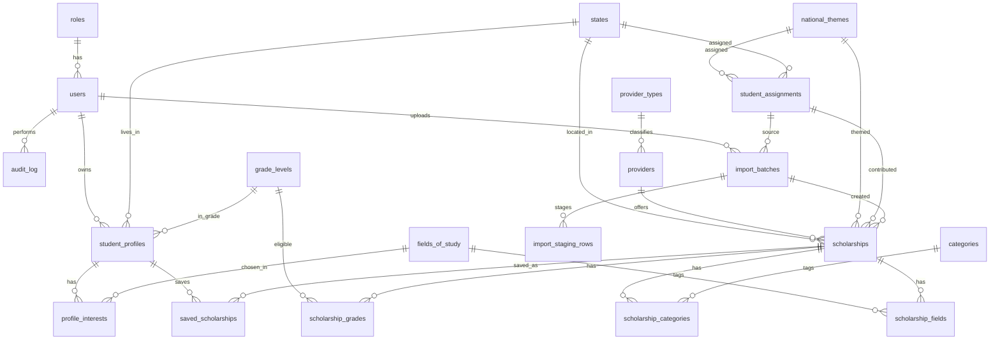

# ERD (matches `sql/001_schema.sql`)

Paste the block into https://mermaid.live to export an image for the iteration report.

Standalone tables: `contact_messages`, `search_log`.

Design choices to defend in your presentation:
- `scholarships.active_url_key` is a generated column that is NULL for archived rows, so MySQL's UNIQUE index enforces "unique among active records" (MySQL has no partial unique index).
- `school_level` is stored but always derived from `scholarship_grades` when saving, so the two cannot disagree.
- `student_assignments` lets the import check theme and sponsor-letter range, and fills in the national theme.
